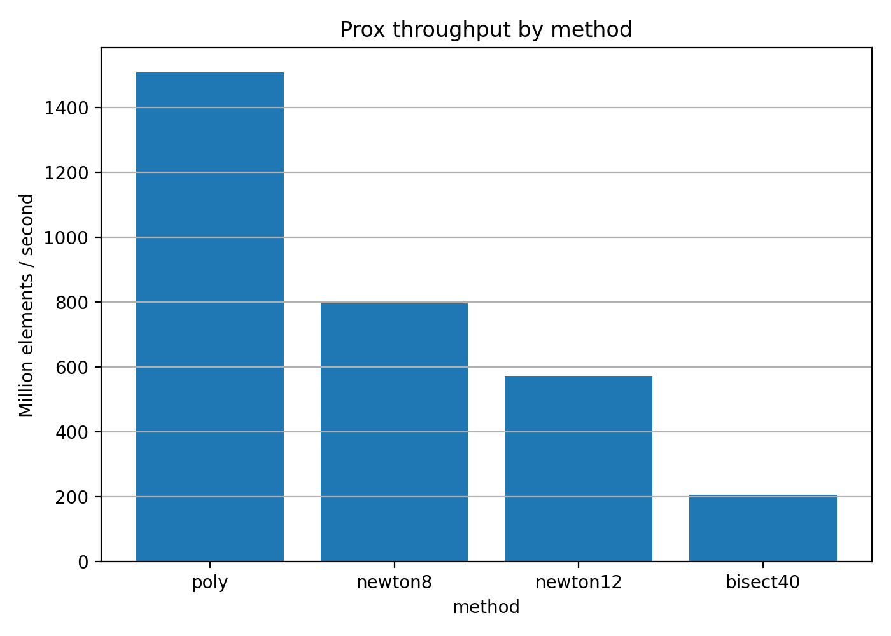
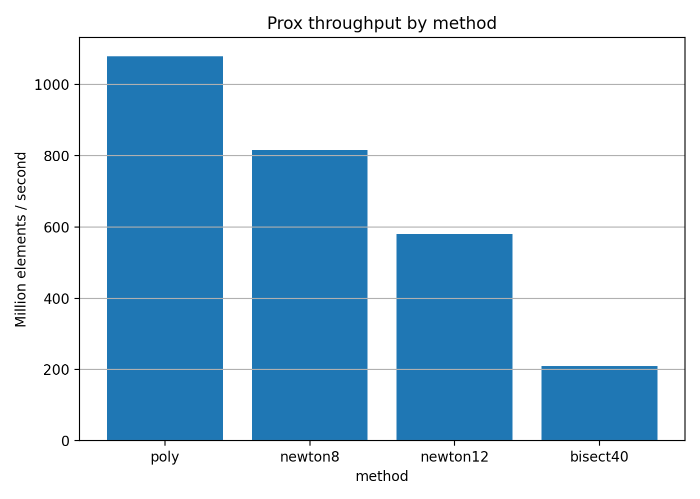
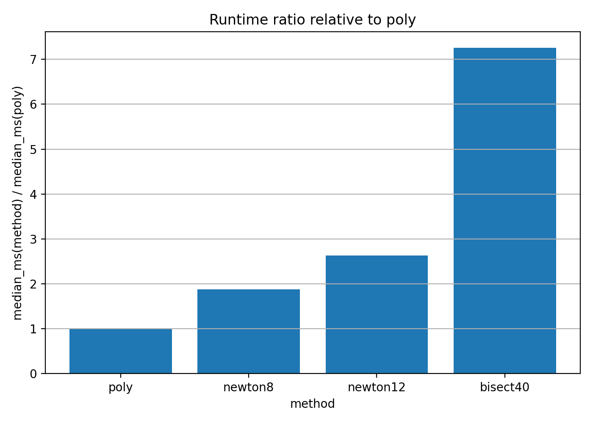
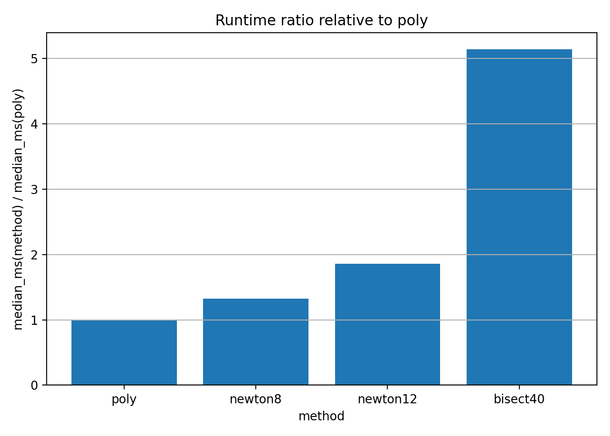

# A100 CUDA benchmark for FAST_LP-PROX

This note summarizes a first CUDA benchmark artifact for the polynomial evaluator of the nonconvex Lp proximal operator in FAST_LP-PROX. The benchmark focuses on the prox evaluator itself; forward-backward / proximal-gradient routines are treated as application demos rather than the primary benchmark target.

## Environment

| Item | Value |
|---|---|
| GPU | NVIDIA A100-SXM4-80GB |
| GPU driver | 580.82.07 |
| GPU memory | 81920 MiB |
| Python | 3.12.13 |
| PyTorch | 2.10.0+cu128 |
| Torch CUDA | 12.8 |
| Platform | Linux-6.6.122+-x86_64-with-glibc2.35 |

## Benchmark setup

- Device: CUDA
- dtype: float32
- lambda: 1.0
- vector size: n = 1,000,000
- active ratio: 0.9
- ymax factor: 10.0
- tested p values: 1/3, 2/5, 3/4
- methods: `poly`, `newton8`, `newton12`, `bisect40`

The `poly` method uses the built-in coefficient tables when available. All tested p values in this artifact use built-in tables.

## Prox evaluator performance

| p   |   poly_median_ms |   poly_throughput_M_elems_s | newton8_speedup_vs_poly   | newton12_speedup_vs_poly   | bisect40_speedup_vs_poly   | all_finite   |
|:----|-----------------:|----------------------------:|:--------------------------|:---------------------------|:---------------------------|:-------------|
| 1/3 |           0.6631 |                     1508.16 | 1.87x                     | 2.64x                      | 7.25x                      | True         |
| 2/5 |           0.6629 |                     1508.58 | 1.90x                     | 2.63x                      | 7.29x                      | True         |
| 3/4 |           0.9281 |                     1077.53 | 1.32x                     | 1.86x                      | 5.14x                      | True         |

All benchmark outputs were finite for all methods and all tested p values.

### Throughput plots






### Speedup plots






## Accuracy validation

Accuracy is measured against the high-accuracy reference used by `scripts/validate_accuracy.py`, on a sampled subset of 100,000 points from the benchmark distribution.

| p   |   max_abs_err |   mean_abs_err |   max_rel_err |   mean_rel_err |
|:----|--------------:|---------------:|--------------:|---------------:|
| 1/3 |      1.36e-06 |       2.48e-07 |      1.48e-07 |       3.24e-08 |
| 2/5 |      1.32e-06 |       2.15e-07 |      1.55e-07 |       2.66e-08 |
| 3/4 |      1.62e-06 |       2.5e-07  |      2.23e-07 |       3.37e-08 |

## Residual validation

Residual validation is measured on active samples using `scripts/validate_residual.py`. Objective gaps are measured against the same reference path used by the script.

| p   |   max_abs_residual |   mean_abs_residual |   max_abs_obj_gap_vs_ref |   mean_abs_obj_gap_vs_ref |
|:----|-------------------:|--------------------:|-------------------------:|--------------------------:|
| 1/3 |           1.36e-06 |            2.73e-07 |                 9.29e-13 |                  6.55e-14 |
| 2/5 |           1.31e-06 |            2.37e-07 |                 8.63e-13 |                  5.35e-14 |
| 3/4 |           1.6e-06  |            2.73e-07 |                 1.3e-12  |                  7.34e-14 |

## Main observation

On an NVIDIA A100-SXM4-80GB GPU, the polynomial Lp prox evaluator reaches approximately 1.08B to 1.51B elements/s for p in {1/3, 2/5, 3/4}. Relative to iterative baselines, `poly` is about 1.3x to 1.9x faster than `newton8`, 1.9x to 2.6x faster than `newton12`, and 5.1x to 7.3x faster than `bisect40`, while maintaining float32-level agreement with the reference methods.

## Reproduction commands

```bash
python -m pytest -q

python scripts/benchmark_prox.py   --device cuda   --dtype float32   --p 0.3333333333333333   --n 1000000   --methods poly,newton8,newton12,bisect40   --warmup 10   --repeats 30   --output results_cuda/prox_benchmark_p_1_3_cuda.csv

python scripts/validate_accuracy.py   --device cuda   --dtype float32   --p 0.3333333333333333   --n 1000000   --sample-n 100000   --methods poly,newton8,newton12,bisect40   --output results_cuda/accuracy_p_1_3_cuda.csv

python scripts/validate_residual.py   --device cuda   --dtype float32   --p 0.3333333333333333   --n 1000000   --sample-n 100000   --methods poly,newton8,newton12,bisect40   --output results_cuda/residual_p_1_3_cuda.csv
```

Repeat the same commands for p = 0.4 and p = 0.75.

## Artifact policy

The raw benchmark CSVs and generated figures are useful as experimental artifacts, but they should not be committed to the main source repository unless intentionally versioning benchmark outputs. For the current project state, commit the Markdown report and selected lightweight figures only if desired; keep raw results in local storage, cloud storage, or a release artifact.
