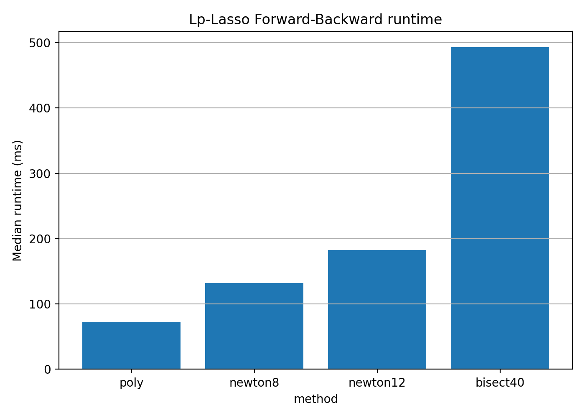
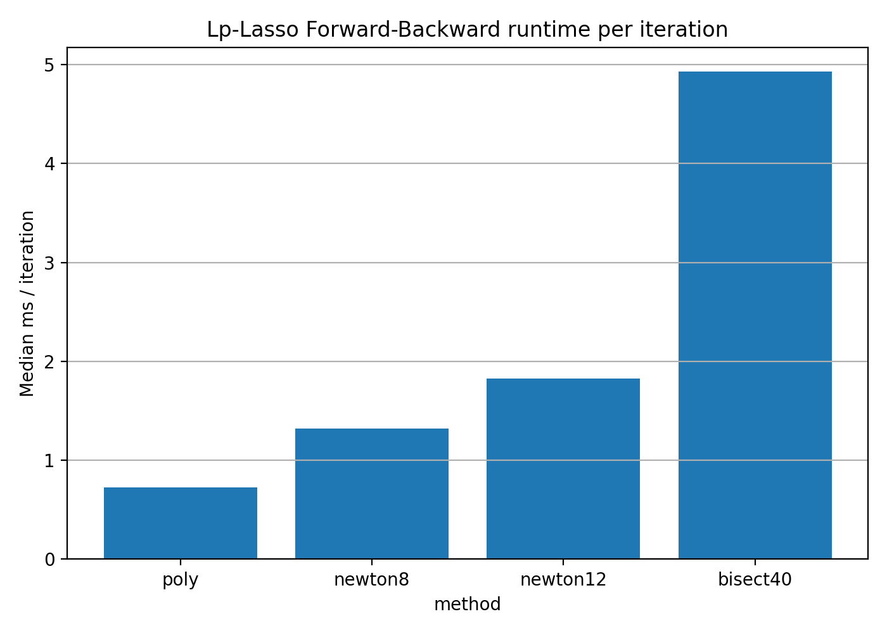
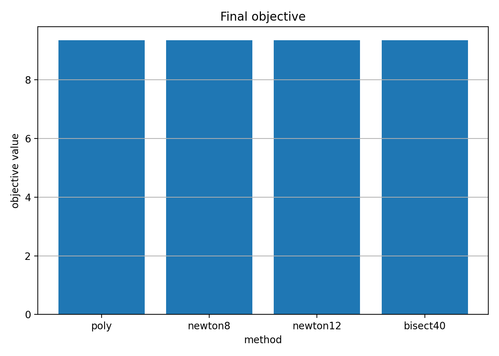
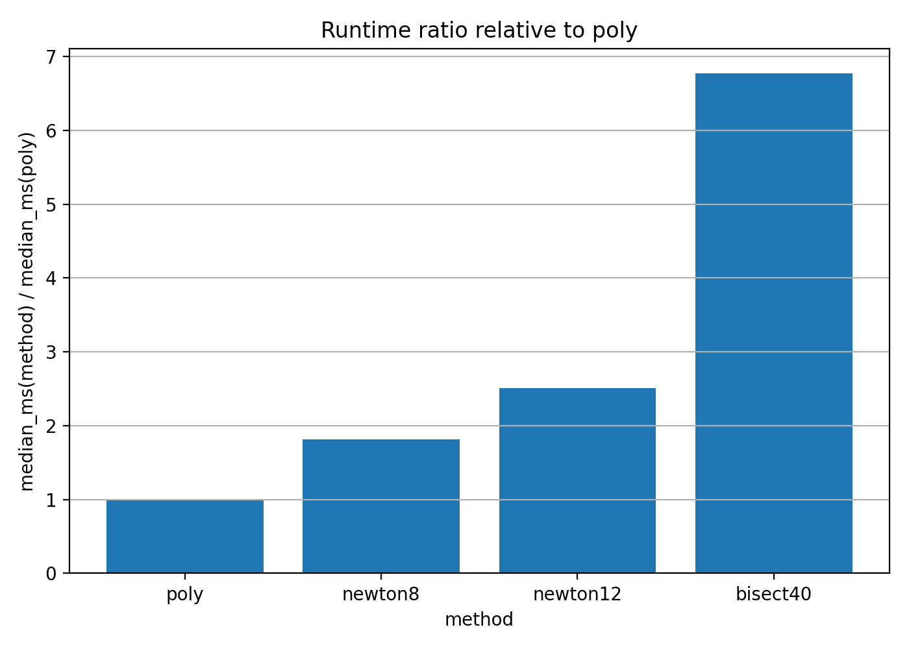

# Lp-Lasso Forward-Backward CUDA demo

This document summarizes a CUDA application benchmark for using the fast Lp proximal evaluator inside a Forward-Backward loop for a synthetic nonconvex Lp-Lasso problem.

This is an application demo, not a new optimization algorithm. The goal is to verify that the Lp prox evaluator can be inserted into an iterative optimization loop and that the polynomial prox backend gives end-to-end runtime benefits while preserving essentially the same algorithmic output as iterative prox baselines.

---

## Problem

The synthetic Lp-Lasso problem is

```math
\min_x \frac{1}{2}\|Ax-b\|_2^2 + \lambda \sum_i |x_i|^p,
\qquad 0 < p < 1.
```

A Forward-Backward step is

```math
y_k = x_k - \alpha A^\top(Ax_k-b),
```

followed by

```math
x_{k+1}
=
\operatorname{prox}_{\alpha\lambda|\cdot|^p}(y_k).
```

The same Forward-Backward loop is run with different prox backends:

| Method | Role |
|---|---|
| `poly` | Chebyshev polynomial prox evaluator |
| `newton8` | 8-step safeguarded Newton prox baseline |
| `newton12` | 12-step safeguarded Newton prox baseline |
| `bisect40` | 40-step bisection prox baseline |

---

## Benchmark setup

The CUDA benchmark used the following problem configuration:

| Parameter | Value |
|---|---:|
| p | 1/3 |
| lambda | 0.05 |
| m | 2000 |
| n | 4000 |
| true sparsity | 200 |
| iterations | 100 |
| device | cuda |
| dtype | float32 |

The benchmark measures end-to-end Forward-Backward runtime, including both the dense least-squares gradient computation and the Lp prox evaluation.

---

## Results

| Method | Median runtime | ms / iter | Runtime ratio vs poly | Final objective | Nonzeros |
|---|---:|---:|---:|---:|---:|
| `poly` | 72.812 ms | 0.728 | 1.00x | 9.342375 | 135 |
| `newton8` | 132.104 ms | 1.321 | 1.81x | 9.342376 | 135 |
| `newton12` | 182.922 ms | 1.829 | 2.51x | 9.342376 | 135 |
| `bisect40` | 492.963 ms | 4.930 | 6.77x | 9.342377 | 135 |

The polynomial prox backend gives a clear end-to-end speedup in this application workload:

- 1.81x faster than `newton8`
- 2.51x faster than `newton12`
- 6.77x faster than `bisect40`

The final objective values and sparsity levels are essentially identical across prox backends, indicating that the faster polynomial prox evaluator does not materially change the algorithmic output in this benchmark.

---

## Figures

### Runtime



### Runtime per iteration



### Final objective



### Runtime ratio vs poly



---

## Interpretation

This experiment supports the intended role of `fast-lp-prox`: the package is primarily a fast Lp prox evaluator, and the Forward-Backward loop is an application workload showing how the evaluator can be used inside an optimization algorithm.

The result should not be interpreted as a claim of a new Forward-Backward algorithm. Instead, it shows that replacing iterative scalar prox solvers with the polynomial prox evaluator can improve the runtime of a standard Lp-regularized iterative method while preserving essentially the same objective value and sparsity pattern.

For dense least-squares problems, matrix multiplications may dominate runtime. Therefore, end-to-end algorithm speedups can be smaller than isolated prox-evaluator speedups. In this benchmark, however, the prox backend remains sufficiently important that the polynomial evaluator gives a visible end-to-end improvement.

---

## Reproduction command

```bash
python scripts/benchmark_lp_lasso_fb.py \
  --device cuda \
  --dtype float32 \
  --p 1/3 \
  --m 2000 \
  --n 4000 \
  --sparsity 200 \
  --num-iters 100 \
  --methods poly,newton8,newton12,bisect40 \
  --warmup 3 \
  --repeats 10 \
  --output results_cuda/lp_lasso_fb_p_1_3_cuda.csv
```

Generate figures with:

```bash
python scripts/plot_lp_lasso_fb_results.py \
  --input results_cuda/lp_lasso_fb_p_1_3_cuda.csv \
  --output-dir figures_cuda
```

---

## Notes

The raw CSV and generated figures are treated as benchmark artifacts. Large result bundles should not be committed to the repository. This document records the key benchmark summary and selected figures.
