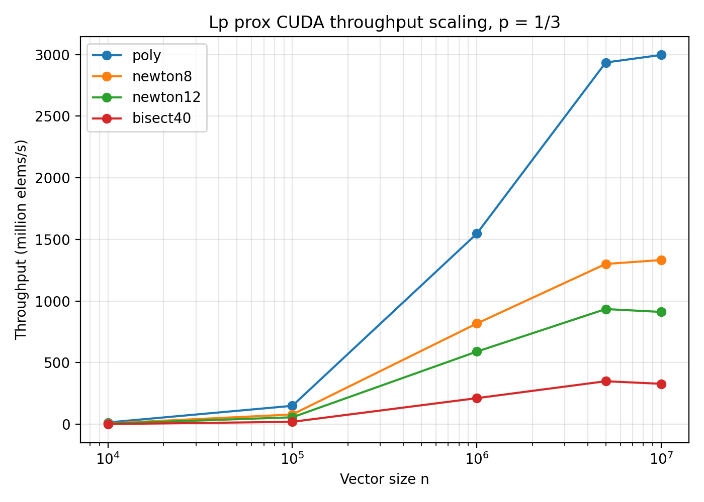
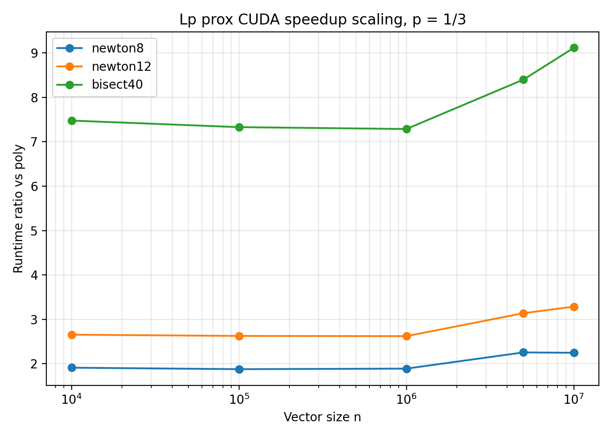
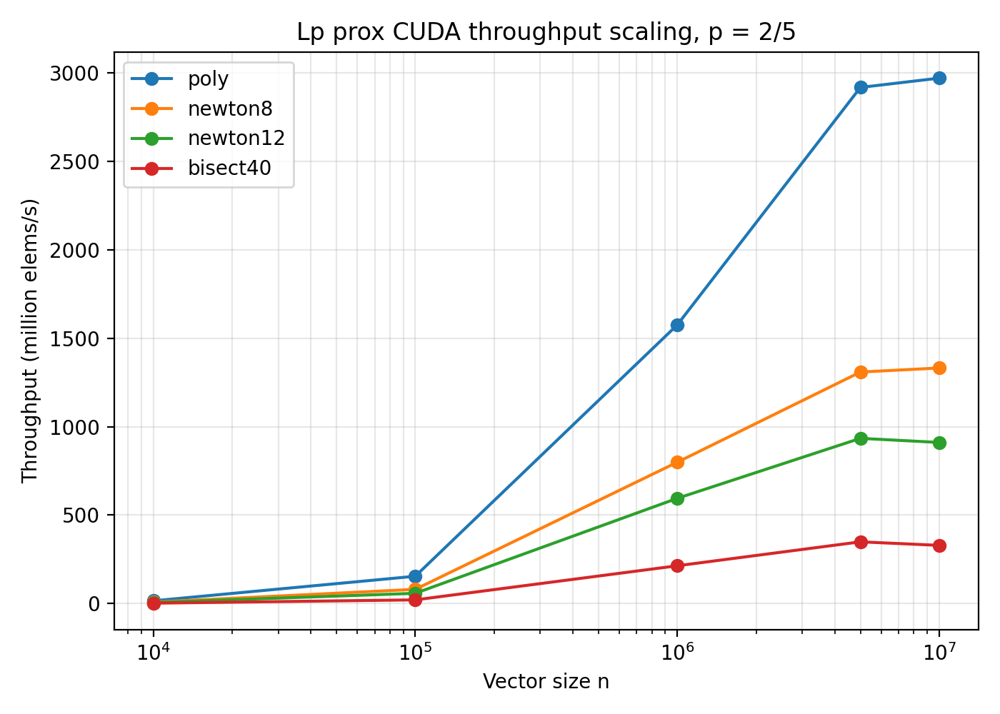
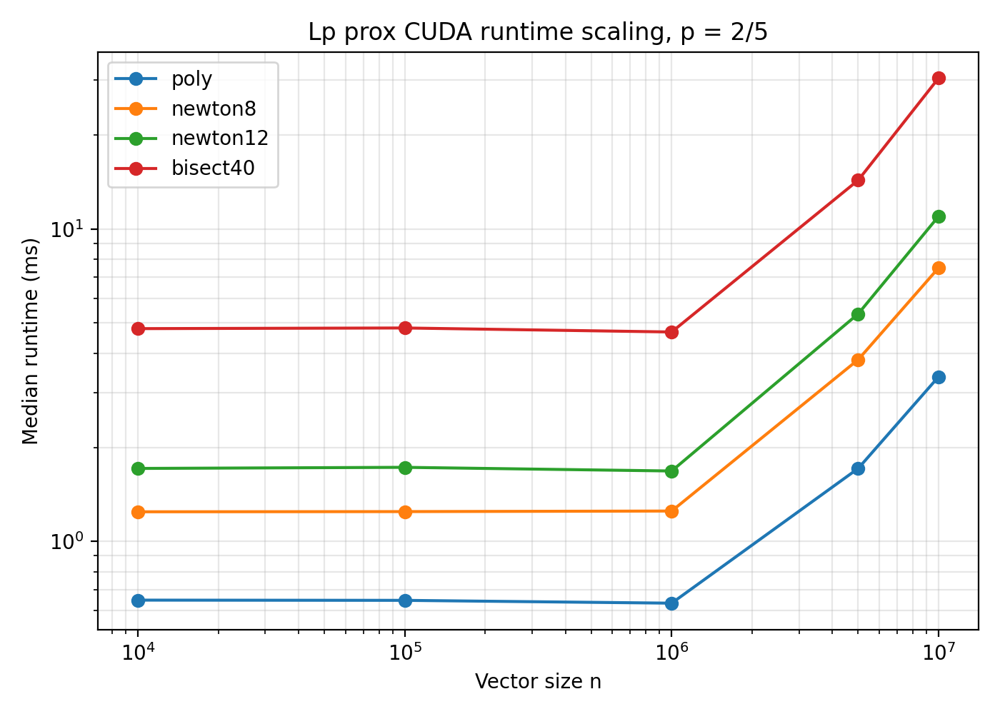
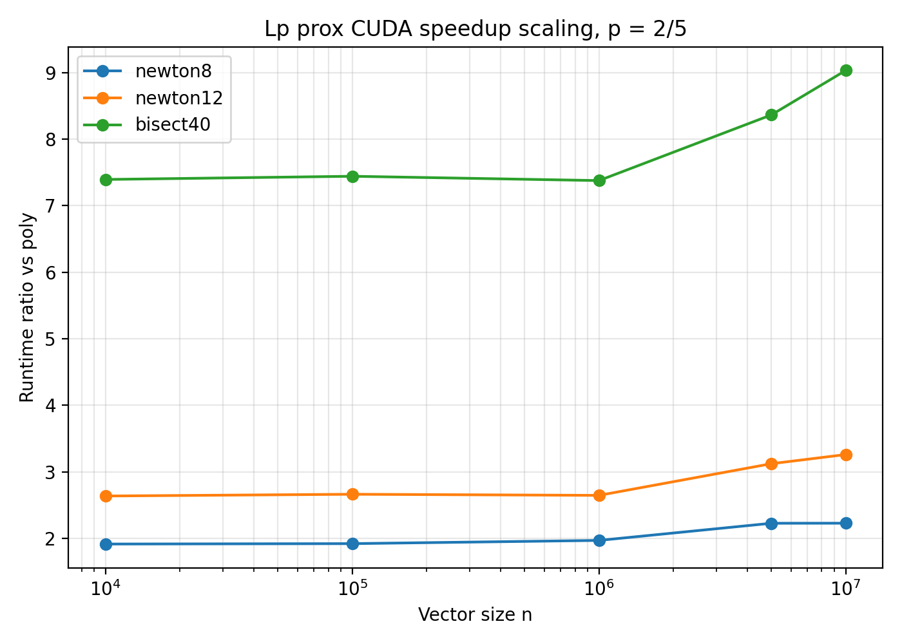
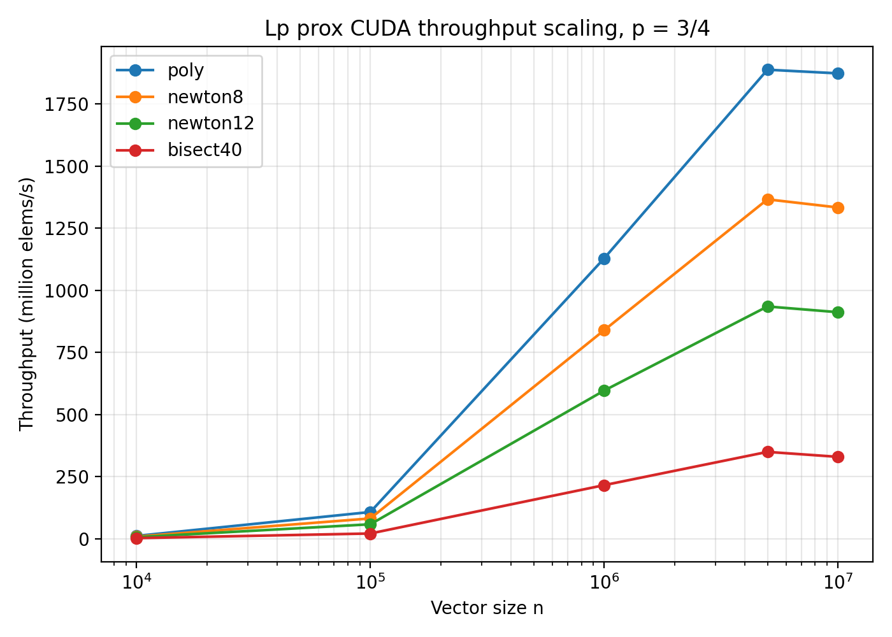
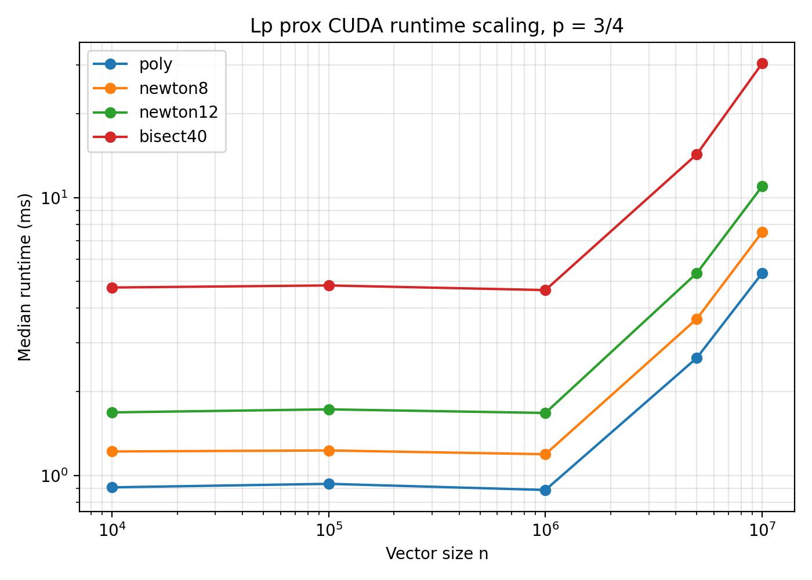
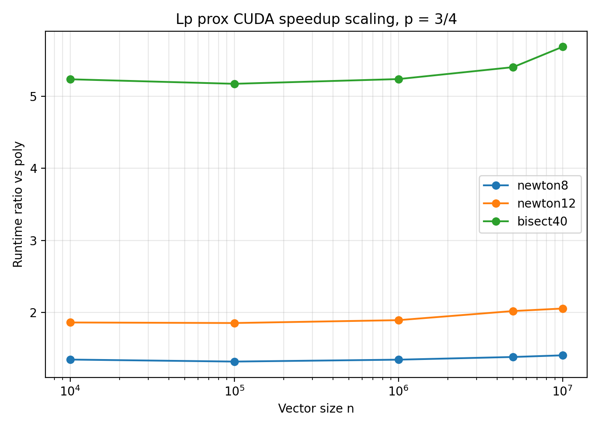

# CUDA prox scaling benchmark

This document summarizes a CUDA scaling benchmark for the scalar/vector nonconvex Lp proximal evaluator in `fast-lp-prox`.

The goal is to evaluate how the prox evaluator behaves as the vector size grows from small batched workloads to million-scale and ten-million-scale workloads.

This benchmark focuses on the isolated prox evaluator, not on an end-to-end optimization algorithm. It is the most direct evidence for GPU-friendly batched Lp prox evaluation.

---

## Environment

```text
GPU: NVIDIA A100-SXM4-40GB
Python: 3.12.13 (main, Mar  4 2026, 09:23:07) [GCC 11.4.0]
PyTorch: 2.10.0+cu128
Torch CUDA: 12.8
CUDA available: True
```

The uploaded result bundle reports:

```text
name, driver_version, memory.total [MiB]
NVIDIA A100-SXM4-40GB, 580.82.07, 40960 MiB
```

---

## Benchmark setup

The benchmark compares:

| Method | Description |
|---|---|
| `poly` | Chebyshev polynomial prox evaluator |
| `newton8` | 8-step safeguarded Newton baseline |
| `newton12` | 12-step safeguarded Newton baseline |
| `bisect40` | 40-step bisection baseline |

The sweep used:

```text
device = cuda
dtype = float32
lambda = 1.0
active_ratio = 0.9
n in {10,000; 100,000; 1,000,000; 5,000,000; 10,000,000}
p in {1/3, 2/5, 3/4}
```

All benchmarked outputs were finite.

---

## Key result at n = 10,000,000

| p | poly median time | poly throughput | speedup vs newton8 | speedup vs newton12 | speedup vs bisect40 |
|---:|---:|---:|---:|---:|---:|
| 1/3 | 3.337 ms | 2997 M elems/s | 2.25x | 3.29x | 9.11x |
| 2/5 | 3.365 ms | 2971 M elems/s | 2.23x | 3.26x | 9.03x |
| 3/4 | 5.340 ms | 1873 M elems/s | 1.40x | 2.05x | 5.69x |

At `n = 10,000,000`, the polynomial evaluator reaches approximately 1.87B to 3.00B elements/s, depending on `p`, and remains substantially faster than Newton and bisection baselines.

---

## Scaling summary

| p | poly throughput at n=10k | poly throughput at n=10M | speedup vs newton8 at n=10M | speedup vs newton12 at n=10M | speedup vs bisect40 at n=10M |
|---:|---:|---:|---:|---:|---:|
| 1/3 | 15 M elems/s | 2997 M elems/s | 2.25x | 3.29x | 9.11x |
| 2/5 | 15 M elems/s | 2971 M elems/s | 2.23x | 3.26x | 9.03x |
| 3/4 | 11 M elems/s | 1873 M elems/s | 1.40x | 2.05x | 5.69x |

The small-`n` cases are dominated by GPU launch and fixed overheads. As `n` grows, throughput increases dramatically and the polynomial evaluator better utilizes the GPU.

---

## Figures

### p = 1/3






### p = 2/5







### p = 3/4







---

## Interpretation

This scaling benchmark supports the main engineering claim of `fast-lp-prox`: the polynomial prox evaluator is well suited to large batched GPU workloads.

For small vectors, runtime is dominated by GPU launch overhead and fixed PyTorch overheads. For large vectors, especially at `n = 5,000,000` and `n = 10,000,000`, the polynomial evaluator achieves high throughput and the speedup over iterative scalar root solvers becomes more pronounced.

The Forward-Backward / Lp-Lasso demos should be interpreted as application workloads. This isolated prox scaling benchmark is the cleaner evidence for GPU-friendly large-scale prox evaluation.

---

## Reproduction command

Example for `p = 1/3`:

```bash
for N in 10000 100000 1000000 5000000 10000000
do
  python scripts/benchmark_prox.py \
    --device cuda \
    --dtype float32 \
    --p 0.3333333333333333 \
    --n $N \
    --methods poly,newton8,newton12,bisect40 \
    --warmup 10 \
    --repeats 30 \
    --output results_cuda/prox_scaling_p_1_3_n_${N}_cuda.csv
done
```

The same sweep can be run for `p = 2/5` and `p = 3/4`.

---

## Notes

Raw result bundles and large generated artifacts should not be committed to the repository. This document records the key summary and selected figures.
